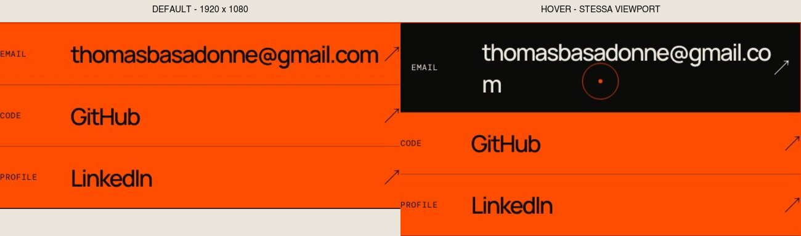

# SYS-01 — Audit sistemico del portfolio

**Ricognizione del 13 novembre 2026 · baseline `d909b1b` · issue #51.**

La consegna documentale e i quattro follow-up sono autorizzati da Thomas il **14 novembre 2026**.
Worktree: `../portfolio-wt-sys01`, branch `docs/sys01-audit`, derivata da `origin/main`.
Non è stata modificata l'applicazione. Il merge non è autorizzato da questa consegna.
I contratti dei due bug sono fissati; anatomia Work, scala 14/16px e alias restano proposte in #81/#82.

## Verdetto

Il sito ha un'identità riconoscibile e una gerarchia principale funzionante. **Non servono un rebrand,
nuovi font o un refactor globale.** Il problema è il contratto dei componenti dentro le colonne:
la geometria cambia durante l'interazione, gli stati sottraggono spazio alla lettura e il testo
informativo usa dimensioni da metadato. La correzione deve fissare questi contratti, non aggiungere
media query fino a far sparire lo screenshot.

Due difetti funzionali riprodotti:

1. **La mail va a capo in hover e focus**, come segnalato da Thomas: padding orizzontale da 0 a 16 px
   per lato, 32 px sottratti al testo. A 1920×1080 e 390×664 una riga diventa due. Non è il cursore.
2. **Il controllo pausa viene coperto dall'identità HUD sui telefoni corti**: a 390×664 il suo centro
   è sotto “TB”; tap/click centrali non arrivano al pulsante. L'attivazione da tastiera funziona.

### Valutazione indicativa (non certificazione WCAG né benchmark)

| Dimensione | /4 | Evidenza e limite |
|---|---:|---|
| Accessibilità | 2 | Focus della mail instabile; pausa coperta. Axe stabilizzato senza violazioni nel campione, non nell'intero prodotto. |
| Performance | 3 | Budget rispettati; animazioni di padding ancora presenti. Nessuna nuova misura di frame rate/LCP. |
| Tema/superfici | 3 | Palette e forced-colors definiti; colori secondari e superfici non tutti semantici. Nessuna richiesta di dark/light switch. |
| Responsive | 3 | Nessun overflow del documento nelle 240 configurazioni; problemi nelle righe e nei controlli. Non equivale a nessun testo spezzato. |
| Integrità del sistema | 3 | Identità coerente; contratti di stato e fonti editoriali da esplicitare. |
| **Totale** | **14/20** | Buona base, rifinitura mirata. |

## 1. Metodo, copertura e provenienza

### Baseline e concorrenza

- `git fetch origin`: `main` e `origin/main` a `d909b1b`.
- PR aperte lette: #76 (nuovo gate), #77 (dipendenze runtime), #78 (dipendenze dev).
  **Nessuna inclusa nella baseline.** Il gate #76 richiede una nuova verifica dopo il merge;
  i bump potrebbero cambiare metriche font, CSS generato o motore dei test.
- #26 e #44 sono **chiuse**, non dipendenze da implementare. #49 e #50 sono chiuse: regia,
  banda portrait e gerarchia della prima schermata si preservano.
- L'issue #75 possiede le frecce emoji su iOS: qui si conserva il contratto delle frecce,
  senza inventare un'altra correzione allo stesso problema.

### Campione riproducibile

`docs/evidence/issue-51/measurements.json` contiene **240 configurazioni / 720 stati**:
Chromium e WebKit × EN/IT × Manrope disponibile/bloccato × staged/fallback × 15 viewport.

Viewport CSS: 320×568, 375×548, 390×664, 600×900, 760×1000, 761×1000, 800×1100,
1024×1366, 1080×1400, 1081×1400, 760×430, 1024×768, 1280×800, 1440×900, 1920×1080.
Le coppie portrait/landscape sono intenzionali: le regole non dipendono solo dalla larghezza.

- Matrice CSS deterministica: chunk WebGL trattenuto con un modulo che non completa la valutazione;
  probe WebGL controllato per selezionare staged o fallback; reduced motion. Misura DOM, non prova del renderer.
- `live-checks.json`: **12 casi** con renderer realmente pronto, motion normale, pausa attraverso il
  controllo vero (tastiera quando il click è bloccato), hover/focus assestati per 450 ms, pagina e drawer Twin.
- `settled-checks.json`: **8 casi** aggiuntivi, attesa 1600 ms e stili nav identici prima/dopo axe;
  touch emulato sui telefoni. Nessuna violazione axe in questo campione stabilizzato.
- Zero `pageerror` nelle finestre delle prime due raccolte. Non è una dichiarazione su tutte le richieste HTTP.
- Screenshot desktop/mobile e drawer letti visivamente. Le coordinate e i testi nel report provengono dal DOM
  e dai sorgenti: le letture visive di refusi inesistenti, nomi e dettagli 3D non sono state trattate come fatti.
- Le prime catture per elemento potevano includere HUD/dock fissi dentro un pannello alto più del viewport:
  conservate solo in scratch privata, **non usate per dichiarare nuove occlusioni del testo**.

### Fonti editoriali

I quattro estratti sanificati, con sezioni di provenienza dichiarate, sono in [`content/`](content/README.md).
Non sono copie integrali. Gli originali nella root del
checkout principale sono intatti (hash confrontati). Non inclusi PDF privati, inventari interni,
percorsi macchina, note di sicurezza, nomi dei prodotti riservati e statistiche interne non pubblicate.
Le ricerche di luglio non descrivono lo stato attuale. Non sono state rieseguite verifiche dei canali social.

**Sequenza documentata:** #51 chiedeva un commit dedicato delle fonti prima dell'audit.
Le copie sono state preparate prima della sintesi; la ricognizione del 13 novembre precede comunque
i commit autorizzati il 14 novembre. La consegna mantiene il commit fonti prima del commit audit,
ma non presenta questo ordine Git come una verifica retroattiva. Nessun originale privato viene versionato.

## 2. Finding → esito proposto → ticket

Nove voci: **1 P1, 5 P2, 3 P3; nessun P0 confermato**. “Decisione di design” significa da approvare,
non correzione obbligatoria e non difetto WCAG dimostrato. I quattro follow-up autorizzati sono
#79 (mail), #80 (pausa), #81 (Work/type) e #82 (token/feedback). Gli ID SYS-* nella tabella sono
identificatori dei finding, distinti dai codici dei titoli delle issue.

| ID | Priorità | Finding ed evidenza | Esito/proposta | Tracking |
|---|---|---|---|---|
| SYS-01 | P2 | Email: righe cambiano con hover/focus; 72/240 configurazioni peggiorano. `index.css:1170–1193`; `scene-stages.css:75–76`. | **Difetto confermato, da correggere.** Geometria identica per stato; indirizzo intero senza lettera orfana. | #79 · bug Pronto |
| SYS-02 | P1 | Pausa 44×44, box y=32.953 a 390×664; identità fino a y=58.781. Centro non colpisce pausa; tap fallisce su entrambi i motori/lingue. `scene-stages.css:114,168`. | **Difetto confermato, da correggere.** Slot interamente visibile e cliccabile fuori dall'HUD; senza toccare la scena. | #80 · bug Pronto |
| SYS-03 | P2 | A 1440×900 IT staged la descrizione delle righe Work varia da 130.28 a 217.39 px: il badge `auto` consuma larghezze diverse. `index.css:971,1016–1028`. | **Decisione di design.** Seconda riga per meta/stato oppure breakpoint basato sul contenitore; non rimpicciolire il testo per salvare quattro colonne. | #81 · Da decidere |
| SYS-04 | P2 | Prosa Experience e sommari Work 12/18 px; capabilities 13.12/19.68; corpo About 16.56/26.496 a 1440. `index.css:914–919,1022–1028,1125–1129`. | **Decisione di design.** Distinguere corpo da label; minimo proposto 14 px, corpo lungo 16 px. Nessuna violazione WCAG inferita dalla sola dimensione. | #81 · Da decidere |
| SYS-05 | P2 | Stato progetto nascosto sotto 1081 px; su telefoni sparisce anche il sommario. Resta kind/periodo, non beta/sideload. `index.css:1606–1608,1897–1899`. | **Decisione di design.** Conservare lo stato nella scansione anche in compatto, riusando lo stesso contenuto; non aggiungere claim. | #81 · Da decidere |
| SYS-06 | P3 | Token motion 180/350/900 ms presenti, ma feedback usa 250/300/350/450/700 ms e curve inline. `index.css:458,468,622,894,1177,1366`. | **Decisione di sistema.** Alias per ruolo; conservare le durate giustificate, non imporre una durata unica. | #82 · Da decidere |
| SYS-07 | P3 | Le capability sono `li`, non azioni; hover modifica padding di 11.2 px per lato e bordo. Nel campione live la prima riga non cresce in altezza. `index.css:888–900`; `PortfolioStory.tsx:99–109`. | **Decisione di design.** Eliminare feedback che suggerisce un click inesistente; non renderle pulsanti finti. | #82 · Da decidere |
| SYS-08 | P2 | Fonti storiche confliggono con scelte già chiuse: vecchio ruolo, CV, prototipi da nominare, OG, solo EN. Anche `CONCEPT.md:90–94` descrive ancora placeholder. | **Gestito nella consegna documentale**: copie sanificate, provenienza e precedenza; Content integrity in CONCEPT allineata. Le ipotesi storiche non sono copy corrente. | #51, commit docs separato |
| SYS-09 | P3 | Colori secondari ripetuti (`#5d5b55`, `#626059`, `#5f5d57`, `#68665f`) e ombre/hairline inline; nessuna scala spacing semantica. | **Decisione di sistema.** Alias per testo/superficie e pochi livelli di ritmo; non sostituire meccanicamente tutti i valori. | #82 · Da decidere |

### SYS-01: riproduzione e causa, non solo screenshot

1. Servire la build della baseline, entrare direttamente in `#contact`.
2. A 1920×1080, osservare la mail su una riga. Hover, poi focus con modalità tastiera.
3. Il box testo passa da **462.41 a 430.41 px**: la `m` finale scende alla seconda riga.
   La riga passa da **91.1875 a 131.78125 px** con Manrope.
4. A 390×664: box da **302 a 270 px**, riga da **56 a 73 px**, una riga → due.
5. A 1024×768: due righe → tre. A 1440×900 la mail è già su due righe a riposo.
6. I due motori e le due lingue confermano; il fallback font non elimina il problema.

L'hover e il focus aumentano il padding. `overflow-wrap:anywhere` rende possibile lo spezzamento,
ma **la variazione di padding è il trigger**. Il cursore è `pointer-events:none` e non riserva spazio.
L'email sizing del fix mobile #71 copriva solo il default: i quattro e2e esistenti passano ancora.

Contratto fissato per il fix #79:
- stesso numero di righe, stessa altezza e stessa geometria riservata fra default/hover/focus/active;
- hover e focus distinguibili attraverso superficie, colore e outline, non reflow;
- ridistribuire label e freccia alle colonne strette prima di ridurre il corpo; una riga quando ci sta,
  eventuale break controllato fra parti dell'indirizzo quando non ci sta, mai una lettera orfana;
- conservare `mailto:` e indirizzo copiabile intero; niente ellissi, `overflow:hidden` o nowrap cieco;
- test della geometria in IT/EN, web/fallback font e staged/fallback; il test deve essere rosso sulla baseline.

### SYS-02: dimensione CSS non equivale ad area utilizzabile

A 390×664 il pulsante va da y=32.953 a 76.953; “TB” da y=12 a 58.781.
L'identità intercetta il centro. Nella griglia di hit-test solo **55/121 punti** colpiscono pausa;
la fascia inferiore esposta è circa **18.172 px**. A 1440×900 tutti i 121 punti raggiungono il controllo.
Click e tap al centro falliscono a 390; focus + Enter cambia correttamente il nome in “Resume/Riprendi”.
La posizione viene calcolata dalla banda e dal `--nav-clearance` anche quando la banda è corta.

La proposta deve preservare **44×44 px effettivi**, non solo il bounding box. Mettere il controllo
in uno slot riservato che non venga spinto sotto l'HUD dal taglio della banda. È una correzione DOM/CSS,
non una modifica della cinematica. Dispositivo fisico iOS ancora da verificare.

## 3. Token proposti contro valori attuali

**Nessun token applicato in questa consegna.** I nomi sono una proposta di contratto; niente framework.
Le dimensioni display restano fluide e legate a `cqi`/altezza nei rami già approvati.

### Tipografia

| Ruolo proposto | Attuale | Proposta | Regola e rischio |
|---|---|---|---|
| `--type-label` | 0.75rem, DM Mono, 1.5; proof usa line-height normal | 0.75rem / 1.5, mono, tracking .04–.06em | Solo codici, metadati, badge, non prosa. Conservare i controlli 44 px. |
| `--type-body-compact` | .75rem Work/Experience, .82rem capabilities | .875rem / 1.5–1.6 | Minimo proposto 14 px, da provare insieme al nuovo layout Work. Aumento altezza prevedibile. |
| `--type-body` | .92–1.08rem About e .92rem drawer | 1rem / 1.6 | Prosa lunga; non innalzare automaticamente le label. |
| `--type-lead` | 1.12–1.4rem / 1.35 | Conservare range e funzione; alias semantico | La lead resta distinta dal corpo, senza introdurre un quarto font. |
| `--type-item-title` | 1.32rem mobile, 1.35–2.35rem desktop | Conservare range, usare misura del contenitore | Prima correggere tracce e badge; non aumentare ogni titolo. |
| Display capitolo/hero | clamp + cqi/vh, tracking −.07/−.078em | Conservare identità e sizing, nominare ruoli | Nessun nuovo rapporto globale imposto ai titoli. Fit reale con font fallback. |

Il rapporto titolo/corpo non è piatto: a 1440 il nome è **84.05 px**, capitoli **53.23 px**,
lead About **20.88 px**, corpo **16.56 px**. Il problema verificato è il salto verso la prosa da 12 px,
non l'assenza di una gerarchia display. Il detector che dice “h1=h2=16px” è un falso positivo.

### Spaziatura e griglia

| Ruolo | Valori attuali | Proposta |
|---|---|---|
| Unità | Multipli frequenti .4/.5/.6/.75/1/1.25/1.5/2rem | Base .25rem; alias .5, .75, 1, 1.5, 2, 3rem, non arrotondamento universale. |
| `--space-inline` | gap .55, .65, 1, 1.25rem | .75rem mobile / 1rem largo, salvo controllo con fit vincolato. |
| `--space-row` | 1.25rem mobile, 1.6rem desktop | Conservare ritmo esterno; padding riservato uguale in tutti gli stati. |
| `--space-field` | 1.5rem, gap 2rem desktop / .75rem mobile | Conservare, alias per drawer. Nessun cambio contestuale al primo fix. |
| `--space-section` | clamp 3–6rem + beat 50svh, banda portrait dedicata | Alias solo per ritmo editoriale; **non sostituire** beat scenici con multipli della scala. |
| Gutter e rail | `--gutter`, `--nav-lane`, `--reading-top`, safe areas già presenti | Conservare. Slot controllo separato con test hit-target; non cambiare `z-index` a caso. |

### Superfici, stati, motion

| Contratto | Attuale | Proposta |
|---|---|---|
| Palette principale | graphite/bone/signal/oxide/muted già token | Invariata; alias testo primario/secondario per ogni superficie. |
| Secondario su bone | Quattro hex vicini | Un alias verificato con contrasto composito; differenze ammesse solo con scopo. |
| Hairline | token scuro/chiaro + rgba .35 contatti | Alias su bone, graphite, signal; stesso peso 1 px. |
| Elevazione | Ombre reading/cases/drawer diverse | Due ruoli: pannello e modal; niente ombra nuova sui piccoli controlli. |
| Feedback veloce | `--motion-fast:180ms`, molti 250 ms inline | 180 ms come feedback; 250 ms come alias hover quando motivato. |
| Disclosure | 300/350 ms con easing diversi | 350 ms mechanical per espansione; niente animazioni di padding delle righe. |
| Reveal | drawer 700 ms, entry 900 ms, canvas 600 ms | Alias distinti; #76 possiede il nuovo gate. Non uniformarli alla cieca. |
| Reduced motion | `.001ms` globale + controller dedicato e grana spenta | Conservare risultato finale immediato e alternativa del controller; ricontrollare feedback dopo le patch. Non dichiarato bug solo dal detector. |

Regole da `CONCEPT.md:55–62`: pointer subordinato allo scroll e disabilitato in reduced motion;
qualità visuale non sacrifica leggibilità. Da qui la scelta: **feedback non deve cambiare la misura
che l'utente sta leggendo**, e la posizione del controllo deve restare indipendente dall'artefatto.

### Matrice degli stati richiesta alle patch

| Componente | Default | Hover | Focus | Active/pressed | Disabled |
|---|---|---|---|---|---|
| Contatto | Etichetta, indirizzo, freccia | Inversione senza reflow | Stessa geometria + outline visibile su entrambi i fondi | Feedback compatibile con touch; nessun hover appiccicato necessario | N/A: link con destinazione valida |
| Riga Work | Tipo, titolo, stato leggibili | Fondo di evidenza; colonne ferme | Stessa evidenza + outline, apre il case | Nessun cambio di testo o altezza | N/A attualmente; niente stato inventato |
| HUD/dock lingua | Label e destinazione accessibile | Nessuna espansione che copre testo | Focus e label equivalenti | Lingua `aria-pressed`, capitolo corrente distinto | N/A attualmente |
| Pausa | Slot 44×44 disponibile | Bordo/colore | Outline + Enter/Space | Icona e nome cambiano coerentemente | Assente se non applicabile, non finta disabilitazione |
| Drawer | Superficie opaca e scroll locale | Solo link/azioni, non paragrafi | Focus trap + ritorno al trigger | Chiusura Escape/backdrop preservata | Nessuno stato globale aggiunto |
| Capability | Informazione, non azione | Nessun invito al click | Nessun tabindex sui li | N/A | N/A |

## 4. Copy e IT/EN, verificati insieme

- Stesso ruolo pubblico, titolo documento e linea di prove; EN default e IT secondaria.
- Prima persona coerente in About, ruolo e contatto; responsabilità dei team distinta dall'autore unico.
- Mapei: perimetro, non metriche; Twin: fixture sintetica distinta dai clienti; Privacy Guard:
  sito illustrativo distinto dall'app; La Fetuseria: vetrina distinta dal gestionale;
  Promptify: sideload distinto dallo Store; SGAGGIO: identità e avvio, non clienti inventati.
  Si verificano i **confini del copy**, non lo stato attuale di tutti quei prodotti.
- I testi IT più lunghi consumano più righe nei metadati Work. Non risolvere abbreviando informazioni
  importanti solo in italiano: correggere la struttura della riga per entrambe le lingue.
- Terminologia tecnica inglese in IT non è automaticamente un errore. DEPTH e lessico del gate sono scelte
  registrate in #26, da non “tradurre meglio” durante questo audit.
- Punteggiatura lunga e serif non sono difetti da rimuovere: il rilevatore segnala un gusto, non un problema
  di comprensione dimostrato. Nessuna riscrittura della bio o del posizionamento proposta.
- Copy sorgente `ui.hudHome` e label visibile sono distinguibili attraverso `aria-labelledby`: non riaprire
  il finding label-in-name già risolto.
- Gli stati di rilascio meritano visibilità anche nella card compatta (SYS-05); non nuove etichette commerciali.

## 5. Confine con #26 e altre issue

**#26 ha chiuso i casi**, #51 definisce le regole e copre le nuove riproduzioni. Conservare:
- titolo inglese identico IT/EN;
- → per controlli interni, ↗ per uscite, mail inclusa;
- DEPTH, voce dello strumento e grana;
- focus restore WebKit, Enter/Space nativi, skip link e label-in-name già corretti.

Non riaprire particelle/rAF sulla base di vecchi report. Il problema del glyph iOS resta #75.
Il gate #76/#17, la regia #50 e la banda #49 non vengono ridisegnati. #46 possiede la verifica finale
cross-channel e fisica; #47 il futuro contenuto Hermes. Nessun cambio a profili, dominio o social.

## 6. Detector e falsi positivi

Una sola esecuzione del detector sul **built HTML** (`detector.json`):
- `flat-type-hierarchy`: falso positivo, smentito dai computed style sopra.
- `repeating-stripes-gradient`: geometria decorativa del fallback tecnico; nessuna prova di costo o ostacolo.
  **Conservare** in questo ambito.
- `em-dash-overuse`: advisory editoriale, non un bug. **Rimandato**: nessuna evidenza di difficoltà di comprensione;
  non riscrivere il copy per soddisfare la metrica.

Le prime scansioni axe con motion normale intercettavano i colori della nav durante una transizione
indotta dal focus/scroll. I valori non erano stabili. Dopo 1600 ms e confronto prima/dopo:
**0 violazioni negli 8 casi**. Non sono contate come difetti del prodotto.

## 7. Budget e rischio

`pnpm build` + `check-bundle` sulla baseline, valori misurati dallo script del progetto:

| Risorsa | Misura | Limite | Margine |
|---|---:|---:|---:|
| CSS principale raw | 39,555 B | 40,000 B | **445 B** |
| Entry JS gzip | 85,053 B | 90,000 B | 4,947 B |
| Visual JS gzip | 241,439 B | 250,000 B | 8,561 B |
| JS totale gzip | 326,492 B | 330,000 B | **3,508 B** |

Vite segnala il chunk visuale oltre 900 kB raw; non è un gate rosso. Niente nuova dipendenza.
I token si introducono sostituendo dichiarazioni, non appendendo un secondo foglio parallelo.
Screenshot/report non entrano in `dist`: costo runtime zero; peso repository separato.

| Gruppo di patch | Blast radius | Regressione da dimostrare |
|---|---|---|
| Slot pausa | Medio: sticky portrait, short-screen e fallback | Hit-test intera area + tap/click; no overlap con HUD/dock, nome coerente. |
| Stati contatto/capability | Basso/medio: hover/focus condivisi, anche desktop | Matrice sopra, transizione completa e font fallback; rosso prima, verde dopo. |
| Anatomia Work + type compact | Medio: altezza capitolo e disponibilità testi IT | Card, badge, drawer, scroll anchor, banda, contrasto e no-overflow. |
| Token alias | Medio se meccanico: cascade e budget CSS | Computed style + bundle; uno slot per volta, niente glob replacement. |
| Docs sanificati | Rischio privacy/editoriale, nessun runtime | Review del diff pubblico e assenza di PDF/inventari; originali preservati. |

## 8. Consegna e confine delle decisioni — 14 novembre 2026

Thomas ha autorizzato la proposta di separare audit e implementazione in quattro follow-up,
con la consegna in repository delle fonti sanificate e dell'audit. Non è un'approvazione implicita di tutti i token o delle varianti di layout.

1. **Docs:** commit dedicato delle sole fonti sanificate + provenance. Nessun PDF.
2. **Audit:** commit distinto con documento, harness, prove e aggiornamento di Content integrity.
3. **#80 · Pausa (P1, Pronto):** test RED sulla baseline → slot 44×44 effettivo → GREEN touch/tastiera.
4. **#79 · Mail (P2, Pronto):** test RED hover/focus → geometria stabile → GREEN su rami e font.
5. **#81 · Work/type (P2, Da decidere):** confronto A/B, scelta di anatomia e soglia di lettura, poi patch.
6. **#82 · Alias/feedback (P3, Da decidere):** perimetro minimo o solo capability, valori motivati, gate invariati.

La #51 consegna audit e tracking; i fix restano aperti nelle issue dedicate. La chiusura della #51
segue il merge della documentazione, non la guarigione implicita dei bug. Nessun merge o deploy è incluso.

Priorità strumenti: `/impeccable adapt` per slot e contratti responsive;
`/impeccable typeset` per i ruoli di prosa; `/impeccable animate` per feedback senza reflow;
`/impeccable document` per gli alias; `/impeccable polish` solo alla fine.
Set approvato e creato: #79–#82. Non sono aggiunte nove issue per nove osservazioni.

## 9. Verifiche eseguite e criteri della #51

Eseguiti:
- `pnpm run lint`: verde.
- `pnpm run typecheck`: verde.
- `pnpm run check`: **20 file / 121 unit test verdi**, build, budget e risorse/metadata/CSP verdi.
- e2e mail esistenti: **4/4 verdi**, Chromium + WebKit. È evidenza del buco di copertura, non del fix.
- Harness: 240 configurazioni, 12 live, 8 stabilizzate; numeri aggregati via script.
- Originali editoriali preservati per hash; nessuna modifica a `src/`, test o config.

Non eseguiti: intera matrice e2e, Lighthouse, nuovo deploy/live remoto, browser fisico iOS,
Firefox, zoom reale 200%, screen reader, tutti i drawer e tutte le condizioni forced-colors.
I gate completi saranno richiesti alle patch; questo è un audit locale, non accettazione di release.
Per la pubblicazione docs del 14 novembre `pnpm check` è stato rieseguito sul commit fonti:
121 test verdi, asset compilati con nomi e byte invariati. La suite e2e completa e Lighthouse non
sono ripetuti per questa sola consegna documentale: `src/`, `public/`, config, dipendenze e test
non cambiano. Non si attribuisce a questa PR una nuova acceptance browser della UI.

| Criterio #51 | Stato |
|---|---|
| Audit con screenshot e misure | **Soddisfatto nel campione dichiarato.** |
| Token proposti confrontati con attuali | **Soddisfatto come proposta**, applicazione non autorizzata. |
| Ogni finding ha un esito | **Soddisfatto**: confermato da correggere / decisione / rimandato motivato; nessun fix dichiarato senza patch. |
| IT/EN verificati insieme | **Soddisfatto** nella medesima matrice. |
| Patch in commit atomici | **Trasferito a #79–#82**: contratto richiesto a ogni implementazione; questa PR consegna solo documentazione in due commit tematici. |
| Confine con #26 | **Soddisfatto**, decisioni preservate e #75 distinto. |
| Fonti versionate prima del commit audit (decisione 11/11) | **Soddisfatto** dal commit fonti `96ce8e7`, precedente al commit di questo audit; la ricognizione antecedente è dichiarata, non retrodatata. |

**La #51 resta aperta fino al merge della consegna docs.** Dopo il merge sarà chiudibile come audit,
non come dichiarazione che i bug siano risolti: #79/#80 rimangono da implementare, #81/#82 da decidere.
