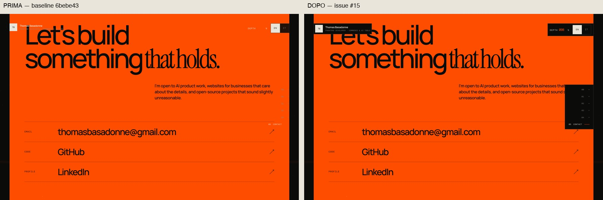
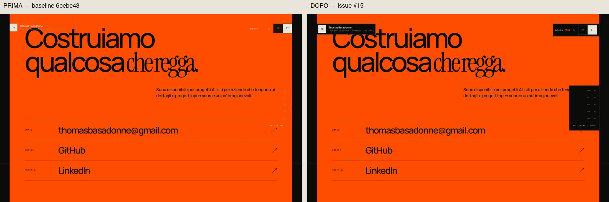
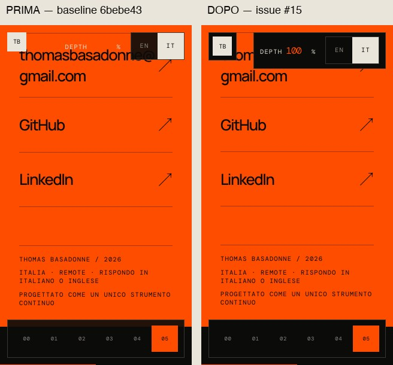
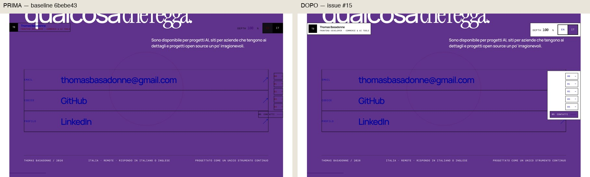
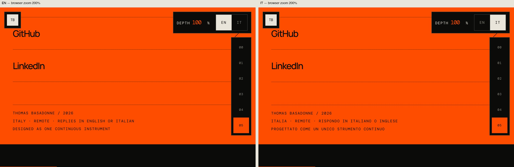
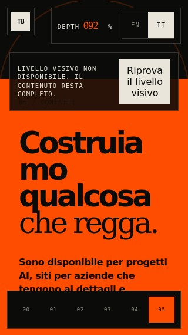

# Issue #15 — HUD contrast acceptance

## Reproduction and policy

Baseline: `6bebe4308c19c37b4d82dfef7ed30a818acbe2ce` (`origin/main` when work started).
The same browser battery was run against a fresh build of that commit and against
this candidate, without changing the candidate's source during either run.

The controller is not broken: the readout reaches `098` midway through contact and
`100` at the bottom. On the baseline, its foreground and composited background are
both `rgb(255, 77, 0)`: **1:1 contrast**, in English and Italian. The identity also
crosses the contact title, and transparent desktop navigation loses contrast.

The fix uses **opaque local graphite surfaces** for identity, tools and navigation.
The rest of the header remains transparent; no chapter detection, blend-mode trick,
copy removal, palette change or progress/controller change is involved. The small
panels deliberately mask story content scrolling underneath them rather than
allowing two text layers to interfere. They do not reserve a full-width header band.
Focus outlines are inset with a contrasting color for selected states. The fallback
notice and landscape navigation are kept clear of the taller tools surface.

## Measurements

`tests/e2e/hud-contrast.ts` records the resolved text color, opacity, size, weight and
text-run rectangle. It captures a normal screenshot, temporarily masks only HUD
glyphs, waits for repaint, and samples six **actually composited background pixels**
per text run. It alpha-composites the foreground and applies the WCAG sRGB relative
luminance calculation. It checks every visible HUD text run, including identity,
role, DEPTH, digits, percent, language options and visible navigation labels; it
rejects functional text relying on filters or blend modes. All current HUD text is
normal-sized and is checked against **4.5:1**, not the large-text exemption.

| Foreground / local surface | Measured minimum |
| --- | ---: |
| Signal DEPTH number / graphite | 5.919983:1 |
| Muted role / inactive controls / graphite | 5.482999:1 |
| Bone / graphite, or graphite / bone | 15.644760:1 |
| Lowest text contrast across all fixed recorded frames | 5.482999:1 |

See [contrast-summary.json](contrast-summary.json) for per-frame minima and DEPTH
foreground/background/value pairs. The full Playwright attachments additionally
contain per-run text rectangles and all pixel samples. The CI uploads its HTML
report even on success, so passing screenshot/measurement attachments remain
available as the `playwright-report` artifact.

## Before / after

Each pair uses the same browser, viewport, language and contact position.

### Desktop English, middle of contact



### Desktop Italian, middle of contact



### Mobile 320 × 568, bottom of contact, Italian



### Forced colors, bottom of contact, Italian



### Actual browser zoom 200%, English and Italian



This last probe used a disposable Chromium profile and a local extension calling
`chrome.tabs.setZoom(tabId, 2)`, verified through `chrome.tabs.getZoom(tabId) === 2`.
It is **browser zoom**, not a CSS transform, page/pinch scale, or just a smaller
viewport. The 1440 × 900 browser viewport reflowed to 720 × 450 CSS pixels. Both
languages retained `100`, zero horizontal overflow, all controls inside the
viewport, and at least 6 CSS pixels between the measured chrome regions. See
[zoom-200.json](zoom-200.json). Screenshots were visually inspected after capture.
The automated suite also retains the equivalent 720 × 450 reflow regression case.

## Executed verification

- `pnpm check`: passed (typecheck, lint, 14 unit tests, build, bundle and link/CSP checks).
- Same final HUD battery against the baseline: **24 failures** on Chromium/WebKit,
  with contrast assertions reproducing the bug (not browser-launch failures).
- Same final HUD battery against the fix: **24 passed** on Chromium/WebKit.
- Full Chromium/WebKit suite: **57 passed, 1 expected skip** (WebGL context-loss
  injection is Chromium-only).
- Browser zoom 200%: passed in EN/IT, including screenshot review.
- The tests cover graphite, bone, contact start/boundary/middle/end and reverse
  scroll, DOM value agreement with progress, hover/focus, forced colors, six
  desktop/mobile/reflow viewports, optional font failure at 320px, WebGL failure
  (including short desktop windows) and keyboard drawer open/close.
- `git diff --check`: passed.

### Re-run

```sh
pnpm install --frozen-lockfile
pnpm check
PORTFOLIO_TEST_PORT=49806 pnpm exec playwright test --grep HUD --trace on --workers 2
PORTFOLIO_TEST_PORT=49806 pnpm exec playwright test --workers 2
```

Choose a free port for concurrent worktrees. Playwright now fails rather than
silently reusing another agent's server; its no-JavaScript case uses the configured
base URL too. Omitting `PORTFOLIO_TEST_PORT` retains the default port 4173.

### Known local limitation

The installed macOS Firefox headless runtime cannot launch even an empty page:
`RenderCompositorSWGL failed mapping default framebuffer` and a sandbox-extension
error precede the launch timeout. No application assertion ran in that native
macOS Firefox runtime. A targeted Firefox Linux probe was subsequently executed
in a disposable Debian container (see below). The repository's Linux CI still
runs all three engines; its result must be read
from the PR, separately from these local Chromium/WebKit results. Physical iOS
hardware and arbitrary OS high-contrast palettes are not certified by emulation.

## CI follow-up

The initial Linux CI exposed two platform/layout differences and a fallback-font
case not visible in the first local run. WebKit Linux's `HighlightText` / `Highlight`
pair measured only **3.772361:1**. Selected HUD controls now use inverse `Canvas` /
`CanvasText` surfaces, retaining the OS palette without relying on that pair.
A short desktop fallback notice is horizontally offset from the navigation rail.
The Italian contact heading's minimum mobile size is reduced from 3.8rem to 3.2rem:
with blocked optional fonts, “Costruiamo” otherwise painted 3px beyond a 320px
viewport even though no element box overflowed. The new font-failure test failed
on the previous CSS and passes with the smaller heading; no copy is removed.
Browser test setup also settles fragment hydration and font metrics before the
intentional bottom scroll, avoiding a WebKit navigation/reflow race.

### Firefox Linux fallback-font probe

A disposable Debian 12 ARM64 container reproduced the remaining Linux Firefox
font-failure edge: at 320px, the contact heading still painted to x=322.07 even
after reducing its minimum size. Narrow contact headings now allow emergency
word wrapping, so a long fallback-font word wraps rather than losing characters.
The retry button also shrinks/wraps within its notice instead of relying on macOS
font metrics. Its containment is asserted in the shared geometry helper.
The fallback tests explicitly block both fonts and the optional visual chunk.

The same isolated Firefox 151 probe now measures scrollWidth/clientWidth **320/320**
and confirms that the retry control stays inside its own panel. This is a targeted
Linux fallback-layout check, not a claim that the full Firefox suite ran on macOS.
See [linux-firefox.json](linux-firefox.json).



## Scope and risk

Production changes are CSS-only and scoped to chrome surfaces, focus treatment,
and fallback/landscape clearance, plus the narrow contact-heading minimum.
`Hud.tsx`, `PortfolioStory.tsx`, professional
copy, DEPTH semantics and the controller remain unchanged. Rollback is a revert
of the CSS change; there is no data migration or persistence change.
